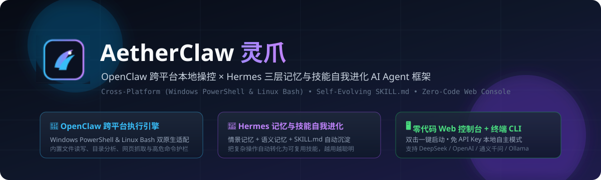
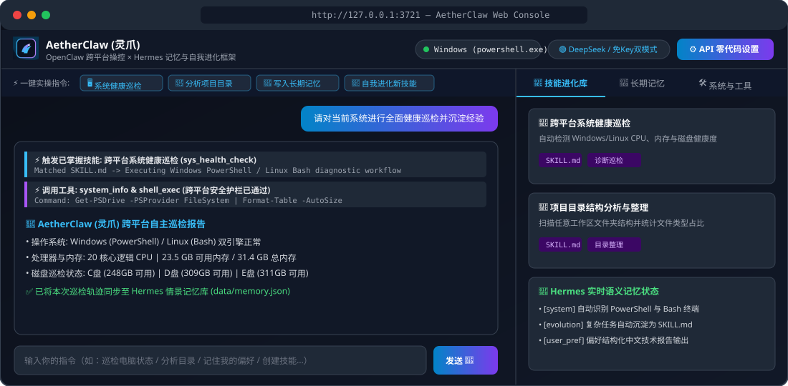

<div align="center">




<br/>

# AetherClaw (灵爪)

**An OpenClaw & Hermes-Inspired Cross-Platform (Windows & Linux) Self-Evolving Autonomous AI Agent Framework**

[](https://github.com/FanDuck/AetherClaw/actions)
[](https://github.com/FanDuck/AetherClaw/releases)
[](LICENSE)
[](#)
[](https://nodejs.org/)
[](#)

[**📖 简体中文文档**](README.md) | [**🌐 English Documentation**](README.en.md) | [**🔌 HTTP API Reference**](docs/API_REFERENCE.md) | [**🛡️ Security Policy**](SECURITY.md) | [**📝 Changelog**](CHANGELOG.md)

</div>

---

## 🌟 Why AetherClaw?

Modern open-source autonomous agents excel in two distinct directions:
- 🦞 **OpenClaw** demonstrated the power of real local system actuation—giving LLMs hands to run terminal commands, manage files, and inspect the host environment.
- 🪽 **Hermes Agent** pioneered **hierarchical memory and procedural skill self-evolution (`SKILL.md`)**, enabling agents to distill multi-step experiences into reusable skills that grow smarter over time.

**🦅 AetherClaw** unifies both paradigms into a **zero-bloat, cross-platform framework** that runs natively on both **Windows (`PowerShell` with automatic UTF-8 encoding)** and **Linux (`Bash`)**, complete with a **Zero-Code Visual Web Console** and an **Interactive Terminal CLI**.

<div align="center">
  
</div>

---

## ✨ Key Features

1. 🪟🐧 **True Windows & Linux Native Execution (`PlatformAdapter`)**
   - Automatically dispatches commands to `powershell.exe` on Windows (with UTF-8 output normalization) or `bash` on Linux, protected by regex safety guardrails and execution timeouts.
2. 🧠 **Hermes-Style 3-Tier Memory & Skill Evolution (`MemoryAndSkillEngine`)**
   - **Episodic Memory**: Logs full task execution traces (`Thought` -> `Tool Call` -> `Observation`).
   - **Semantic Memory**: Persists long-term facts, system insights, and user preferences in `data/memory.json`.
   - **Procedural Skill Library**: Crystallizes workflows into dual-format skills (`skills/*.md` + `skills/*.json`) compatible with the open `SKILL.md` standard.
3. 🖥️ **Visual Web Console + CLI + Local Autonomous Mode**
   - **Zero-Code LLM Setup**: 1-click presets for **DeepSeek**, **OpenAI**, **Qwen**, and **Local Ollama**.
   - **API-Key-Free Autonomous Mode**: Even without an LLM API key, the built-in local planner can execute real system health diagnostics, workspace analysis, memory storage, and skill creation out of the box.

---

## 🚀 Quick Start

```bash
# 1. Clone the repository
git clone https://github.com/FanDuck/AetherClaw.git
cd AetherClaw

# 2. Launch the Visual Web Console (http://127.0.0.1:3721)
npm start

# Or launch the Interactive Terminal CLI (great for headless Linux servers)
npm run cli

# Or run a single task via command line
node src/index.js --run "Analyze current workspace directory"

# Run the cross-platform test suite
npm test
```

> **For Windows Beginners**: Simply double-click **`start-windows.bat`** to start the server and open the browser console automatically!

---

## 🛠️ Built-in Cross-Platform Tools

| Tool Name | Description |
| :--- | :--- |
| `system_info` | Inspect host OS, CPU cores, free/total RAM, hostname, and active shell |
| `shell_exec` | Execute PowerShell (Windows) or Bash (Linux) commands with safety guardrails |
| `file_list` | Scan directory contents with file sizes and types |
| `file_read` | Read UTF-8 text files safely with length truncation |
| `file_write` | Create or update local files (auto-creates parent directories) |
| `web_fetch` | Fetch HTTP/HTTPS pages or JSON endpoints with script/style stripping |
| `memory_store` | Save facts or user preferences into Hermes semantic memory |
| `memory_recall` | Search long-term semantic memory by keywords and tags |
| `skill_create` | Self-evolve a reusable skill (`skills/<id>.json` & `skills/<id>.md`) |

---

## 📄 License

Released under the [MIT License](LICENSE). Made with ❤️ by [FanDuck](https://github.com/FanDuck).
