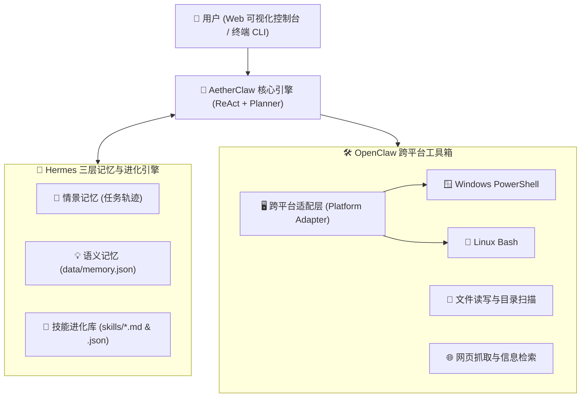

<div align="center">

# 🦅 AetherClaw (灵爪)

**融合 OpenClaw 跨平台系统操控与 Hermes 长期记忆/自我进化的下一代开源 AI Agent 框架**  
*A Cross-Platform (Windows & Linux) Self-Evolving Autonomous AI Agent Framework*

[](https://github.com/FanDuck/AetherClaw/actions)
[](LICENSE)
[](#)
[](https://nodejs.org/)
[](#)

[**简体中文**](README.md) | [**English**](README.en.md)

</div>

---

## 🌟 项目简介 (Introduction)

**AetherClaw (灵爪)** 是一个专为 **Windows** 与 **Linux** 打造、零重度依赖、开箱即用的开源自主智能体（Autonomous AI Agent）框架。它汲取了当今两大热门开源智能体的核心精髓：

1. 🦞 **OpenClaw 风格的跨平台本地操控能力**：自动识别当前操作系统（Windows 自动调用 `PowerShell` 并处理 UTF-8 编码，Linux 自动调用 `Bash`），内置文件读写、目录分析、网页抓取、系统巡检与高危命令拦截护栏。
2. 🪽 **Hermes Agent 风格的三层记忆与技能自我进化 (Self-Evolution)**：
   - **情景记忆 (Episodic Memory)**：自动记录每一次任务规划与工具调用轨迹。
   - **语义记忆 (Semantic Memory)**：持久化存储用户习惯、系统环境知识与偏好（`data/memory.json`）。
   - **程序性技能库 (Procedural Skills)**：能够将复杂任务的解决步骤自动沉淀为开源标准的 `skills/*.md` (`SKILL.md`) 与 `.json` 插件，实现**越用越聪明**的闭环进化。
3. 🖥️ **零代码可视化 Web 控制台 + 终端 CLI 双模式**：不懂编程也能双击一键启动，在可视化界面中一键配置 DeepSeek / OpenAI / 通义千问 / Ollama 本地模型，实时观察 Agent 的每一步「思考 → 工具调用 → 观察结果」。

---

## 🏗️ 核心架构 (Architecture)



---

## ✨ 与同类框架对比 (Feature Comparison)

| 特性维度 | OpenClaw | Hermes Agent | 🦅 **AetherClaw (灵爪)** |
| :--- | :---: | :---: | :---: |
| **原生跨平台支持** | 偏重 Unix/macOS | 偏重 Linux/WSL | ✅ **Windows (PowerShell) & Linux (Bash) 双原生** |
| **长期记忆与技能自进化** | 基础插件机制 | ✅ 强 (`SKILL.md` 自进化) | ✅ **内置三层记忆 + 自动生成 `SKILL.md`** |
| **零代码可视化 Web 控制台** | 需额外配置网关 | 主要是终端 CLI | ✅ **自带可视化控制台 + CLI 双模式** |
| **免 API Key 本地实操模式** | ❌ 必须先配 Key | ❌ 必须先配 Key | ✅ **内置本地自主引擎，免 Key 也可实操体验** |
| **安装复杂度** | 依赖较多 | Python 虚拟环境依赖 | ✅ **零第三方臃肿依赖，有 Node 即可一键运行** |

---

## 🚀 快速开始 (Quick Start — 小白 1 分钟上手)

### 前置条件
确保电脑已安装 [Node.js](https://nodejs.org/)（版本 >= 18 即可）。

### 方式一：一键双击启动（推荐小白用户）
- **Windows 用户**：直接双击项目文件夹中的 **`start-windows.bat`**，会自动启动服务并打开浏览器控制台！
- **Linux 用户**：在终端运行 `./start-linux.sh`。

### 方式二：命令行启动
```bash
# 1. 克隆仓库
git clone https://github.com/FanDuck/AetherClaw.git
cd AetherClaw

# 2. 启动可视化 Web 控制台（默认地址 http://127.0.0.1:3721）
npm start

# 或者启动纯终端交互模式（适合无桌面 Linux 服务器）
npm run cli
```

---

## 🎮 使用指南 (How to Use)

打开浏览器访问 `http://127.0.0.1:3721` 后：

1. **立即体验（无需 API Key）**：
   - 点击界面上方的 **「🖥️ 系统健康巡检」**、**「📂 分析项目目录」**、**「🧠 写入长期记忆」** 或 **「🧬 自我进化新技能」** 快捷按钮，直接观察 AetherClaw 调用你本机的跨平台工具并生成报告。
2. **接入大模型 API（零代码配置）**：
   - 点击右上角 **「⚙️ API 零代码设置」**。
   - 一键选择 **DeepSeek**、**OpenAI**、**通义千问 (Qwen)** 或 **本地免费 Ollama** 预设，填入你的 API Key 并点击保存即可生效！
   - 你的 API Key 仅保存在本机 `data/config.local.json` 中，已被 `.gitignore` 严格排除，**绝不会被上传到 GitHub**。

---

## 📂 项目目录结构 (Directory Structure)

```text
AetherClaw/
├── bin/
│   └── aetherclaw.js          # 全局 CLI 入口
├── src/
│   ├── index.js               # 主程序启动入口 (Web / CLI / 单次运行)
│   ├── core/
│   │   ├── agent.js           # ReAct 自主智能体核心循环与本地自主规划器
│   │   ├── platform.js        # Windows PowerShell & Linux Bash 跨平台适配与安全护栏
│   │   ├── memory.js          # Hermes 三层记忆引擎与 SKILL.md 技能进化系统
│   │   └── config.js          # 零代码持久化配置管理器
│   ├── tools/
│   │   └── index.js           # 跨平台工具注册表 (shell, file, web, memory, skill)
│   ├── server/
│   │   └── index.js           # 零依赖高性能 Web 控制台服务与 REST API
│   ├── ui/
│   │   └── index.html         # 现代化可视化控制台前端界面
│   └── cli/
│       └── index.js           # 交互式命令行终端界面
├── skills/                    # 存放内置与 Agent 自我进化生成的技能 (.json & .md)
├── data/                      # 本地长期记忆存储 (memory.json)
├── tests/
│   └── agent.test.js          # 跨平台自动化单元测试套件
├── .github/workflows/ci.yml   # GitHub Actions (Windows + Linux 自动测试流水线)
├── start-windows.bat          # Windows 一键启动脚本
├── start-linux.sh             # Linux 一键启动脚本
└── package.json
```

---

## 🛡️ 安全机制 (Security Guardrails)

- **高危命令拦截**：`src/core/platform.js` 内置正则安全护栏，默认拦截 `rm -rf /`、`mkfs`、`Format-Volume` 等破坏性系统指令。
- **执行超时保护**：所有终端命令默认带有 15 秒超时熔断，防止死循环卡死系统。
- **密钥隐私隔离**：`.gitignore` 默认忽略 `.env` 与 `data/config.local.json`，保障个人密钥安全。

---

## 🤝 参与贡献 (Contributing)

非常欢迎提交 Issue 或 Pull Request！详情请参阅 [CONTRIBUTING.md](CONTRIBUTING.md)。
你也可以将自己通过 AetherClaw 进化生成的 `skills/*.md` 技能提交到本仓库，与全球开发者共享！

## 📄 开源协议 (License)

本项目基于 [MIT License](LICENSE) 开源，你可以自由地使用、修改和分发。
