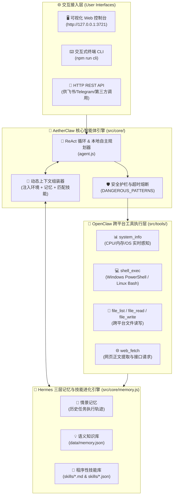
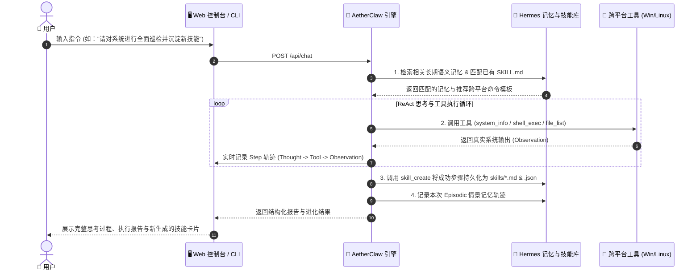

<div align="center">


<br/>

# AetherClaw (灵爪)

**融合 OpenClaw 跨平台本地操控与 Hermes 三层记忆/自我进化的下一代开源自主 AI Agent 框架**  
*An OpenClaw & Hermes-Inspired Cross-Platform (Windows & Linux) Self-Evolving Autonomous AI Agent Framework*

[](https://github.com/FanDuck/AetherClaw/actions)
[](https://github.com/FanDuck/AetherClaw/releases)
[](LICENSE)
[](#)
[](https://nodejs.org/)
[](#)
[](CONTRIBUTING.md)

[**📖 简体中文文档**](README.md) | [**🌐 English Documentation**](README.en.md) | [**🔌 二次开发 API 手册**](docs/API_REFERENCE.md) | [**🛡️ 安全策略**](SECURITY.md) | [**📝 更新日志**](CHANGELOG.md)

</div>

---

## 📑 目录导航 (Table of Contents)

- [💡 为什么诞生 AetherClaw？ (Background & Vision)](#-为什么诞生-aetherclaw-background--vision)
- [✨ 核心亮点 (Key Highlights)](#-核心亮点-key-highlights)
- [🖥️ 可视化控制台预览 (Visual Web Console Preview)](#️-可视化控制台预览-visual-web-console-preview)
- [🏗️ 系统架构与自我进化闭环 (Architecture & Workflow)](#️-系统架构与自我进化闭环-architecture--workflow)
- [📊 与主流开源 Agent 框架全方位对比 (Comparison)](#-与主流开源-agent-框架全方位对比-comparison)
- [🚀 保姆级快速开始 (Quick Start — 1 分钟上手)](#-保姆级快速开始-quick-start--1-分钟上手)
- [🤖 大模型 API 接入全攻略 (Supported LLM Providers)](#-大模型-api-接入全攻略-supported-llm-providers)
- [🛠️ 内置跨平台工具箱详解 (Built-in Tool Suite)](#️-内置跨平台工具箱详解-built-in-tool-suite)
- [🧬 Hermes 技能自我进化规范 (`SKILL.md` Standard)](#-hermes-技能自我进化规范-skillmd-standard)
- [🔌 二次开发与 REST API 接口 (Developer HTTP API)](#-二次开发与-rest-api-接口-developer-http-api)
- [📂 项目目录结构 (Directory Structure)](#-项目目录结构-directory-structure)
- [🗺️ 演进路线图 (Roadmap)](#️-演进路线图-roadmap)
- [❓ 常见问题解答 (FAQ)](#-常见问题解答-faq)
- [🤝 贡献指南与开源协议 (Contributing & License)](#-贡献指南与开源协议-contributing--license)

---

## 💡 为什么诞生 AetherClaw？ (Background & Vision)

在当前的开源 AI 智能体（Autonomous Agent）生态中，**OpenClaw** 与 **Hermes Agent** 代表了两个极具价值的技术方向：
- 🦞 **OpenClaw** 证明了当大模型具备**本地终端执行、文件系统读写、网页检索与即时通讯联动**时，AI 就从“聊天机器人”进化成了真正的“数字员工”。但许多传统框架对 **Windows 原生环境（PowerShell 编码与路径体系）** 兼容性不佳，且配置复杂、依赖繁重。
- 🪽 **Hermes Agent (Nous Research)** 则开创了 **三层记忆架构与程序性技能自我进化（Self-Evolving `SKILL.md`）**，让 Agent 能把解决过的复杂问题沉淀为技能文档，实现“越用越聪明”。但对于不懂编程的普通用户来说，纯命令行与复杂的 Python 虚拟环境往往让人望而却步。

**🦅 AetherClaw (灵爪)** 正是为了将这两者的精髓完美融合并**彻底降低使用门槛**而诞生的开源项目：
> **“左手掌握 OpenClaw 的 Windows/Linux 跨平台真实操控力，右手拥有 Hermes 的长期记忆与技能自进化大脑，再配上一套零代码即可双击启动的可视化 Web 控制台。”**

无论你是**完全不懂编程的电脑小白**，还是希望在 **Windows 工作站 / Linux 云服务器** 上快速部署私有智能体的**开发者与运维工程师**，AetherClaw 都能让你在 1 分钟内跑起来。

---

## ✨ 核心亮点 (Key Highlights)

1. 🪟🐧 **真正的 Windows + Linux 双原生跨平台引擎 (`PlatformAdapter`)**
   - **在 Windows 上**：自动调用 `powershell.exe`，内置 `[Console]::OutputEncoding = [System.Text.Encoding]::UTF8` 自动转码机制，彻底告别中文输出乱码。
   - **在 Linux 上**：自动适配 `/bin/bash` 或系统默认 Shell，完美支持桌面版与无界面（Headless）服务器。
2. 🧠 **Hermes 风格三层记忆系统 (`MemoryAndSkillEngine`)**
   - **情景记忆 (Episodic Memory)**：完整记录每次任务的思考步骤、工具调用参数与返回结果。
   - **语义记忆 (Semantic Memory)**：长期记住用户的个人偏好、主机配置事实与业务规则（持久化在 `data/memory.json`）。
   - **程序性技能库 (Procedural Skills)**：自动将多步骤解决方案沉淀为双格式技能包（人类可读的 `skills/*.md` + 机器可解析的 `skills/*.json`），下次遇到相似任务直接秒级复用！
3. 🖥️ **零代码可视化 Web 控制台 + 终端 CLI + 单次自动化脚本三合一**
   - **Web 控制台模式**：现代化暗黑玻璃拟态界面，实时展示每一步 `思考 (Thought)` → `工具调用 (Tool Call)` → `执行观察 (Observation)`。
   - **免 API Key 本地自主实操模式**：哪怕你还没有申请任何大模型 API Key，内置的本地自主规划器也能直接调用真实工具完成**系统健康巡检、目录分析、记忆读写与技能生成**！
4. 🛡️ **开箱即用的安全护栏 (Security Guardrails)**
   - 内置高危指令黑名单拦截（自动阻断 `rm -rf /`、`mkfs`、`Format-Volume`、Fork 炸弹等破坏性命令）。
   - 命令执行默认 15 秒超时熔断，杜绝进程卡死。
   - API 密钥仅保存在本地 `data/config.local.json`，已被 `.gitignore` 严格隔离，上传代码绝不泄密。
5. ✨ **动态可视化控制台**：粒子网络背景、实时 CPU/内存仪表盘、SSE 流式步骤时间线、打字机输出，并尊重系统"减少动态效果"设置。
6. ⚡ **零第三方重度依赖 (Zero-Bloat Architecture)**
   - 完全基于 Node.js 原生底层模块开发，无需安装编译数十个 C++ 扩展包，拉取仓库即可毫秒级启动。

---

## 🖥️ 可视化控制台预览 (Visual Web Console Preview)

<div align="center">
  
</div>

---

## 🏗️ 系统架构与自我进化闭环 (Architecture & Workflow)

### 1. 整体系统架构图



### 2. 技能自我进化闭环时序图 (Self-Evolution Loop)



---

## 📊 与主流开源 Agent 框架全方位对比 (Comparison)

| 评估维度 | 🦞 OpenClaw | 🪽 Hermes Agent | 🤖 AutoGPT | 🦅 **AetherClaw (灵爪)** |
| :--- | :---: | :---: | :---: | :---: |
| **Windows 原生兼容性** | ⭐⭐ (偏重 Unix) | ⭐⭐ (需 WSL2) | ⭐⭐⭐ | ⭐⭐⭐⭐⭐ **(PowerShell UTF-8 原生适配)** |
| **Linux 服务器兼容性** | ⭐⭐⭐⭐⭐ | ⭐⭐⭐⭐⭐ | ⭐⭐⭐⭐ | ⭐⭐⭐⭐⭐ **(Bash 原生 + CLI 无头模式)** |
| **三层长期记忆系统** | ⭐⭐⭐ | ⭐⭐⭐⭐⭐ | ⭐⭐⭐ | ⭐⭐⭐⭐⭐ **(情景 + 语义 + 技能三层架构)** |
| **技能自我进化 (`SKILL.md`)** | 基础插件 | ⭐⭐⭐⭐⭐ | ❌ | ⭐⭐⭐⭐⭐ **(自动生成 `.md` + `.json` 双格式)** |
| **零代码可视化 Web 控制台** | 需额外部署 | ❌ (仅 CLI) | 需 Docker | ⭐⭐⭐⭐⭐ **(内置单文件 Web 控制台，双击即用)** |
| **免 API Key 本地实操体验** | ❌ | ❌ | ❌ | ⭐⭐⭐⭐⭐ **(不填 Key 也可调用本地工具巡检)** |
| **安装与依赖体积** | 较大 | Python 依赖多 | 极重 (Docker) | ⭐⭐⭐⭐⭐ **(0 第三方重依赖，拉取即跑)** |
| **小白友好度 (不懂编程可用)** | ⭐⭐ | ⭐⭐ | ⭐ | ⭐⭐⭐⭐⭐ **(提供双击启动脚本与中文全界面)** |

---

## 🚀 保姆级快速开始 (Quick Start — 1 分钟上手)

### 第一步：准备基础环境
确保你的电脑已安装 **[Node.js](https://nodejs.org/)**（建议版本 `v18.0` 及以上，支持 Windows 10/11 与主流 Linux 发行版）。
- 检查方法：打开终端输入 `node -v`，能看到版本号即可。

### 第二步：下载本项目
- **如果你会用 Git**：
  ```bash
  git clone https://github.com/FanDuck/AetherClaw.git
  cd AetherClaw
  ```
- **如果你完全不懂编程**：
  直接点击本页面右上角绿色的 **`<> Code`** 按钮 ➡️ 点击 **`Download ZIP`** 下载压缩包并解压到任意文件夹！

### 第三步：启动运行（任选一种方式）

#### 🟢 方式 A：双击一键启动（最推荐电脑小白）
- **Windows 用户**：在文件夹里找到 **`start-windows.bat`**，鼠标**双击**它！程序会自动启动并弹出浏览器打开控制台 `http://127.0.0.1:3721`。
- **Linux 用户**：赋予执行权限并运行：
  ```bash
  chmod +x start-linux.sh && ./start-linux.sh
  ```

#### 🔵 方式 B：通过命令行启动（适合开发者与服务器）
```bash
# 1. 启动可视化 Web 控制台（默认监听 http://127.0.0.1:3721）
npm start

# 2. 启动纯终端交互式 CLI 模式（适合无桌面的 Linux 云服务器 SSH 使用）
npm run cli

# 3. 单次指令执行模式（适合写进定时任务 Cron 或批处理脚本）
node src/index.js --run "请对当前系统进行全面健康巡检"

# 4. 运行跨平台自动化单元测试套件 (20 项全覆盖测试)
npm test
```

#### 🐳 方式 C：Docker 容器化一键部署（适合 Linux 云服务器 / 群晖 / 飞牛 NAS）
```bash
# 一键后台启动并持久化挂载 ./data 与 ./skills 目录
docker compose up -d

# 查看启动日志与自动生成的访问令牌链接
docker compose logs -f
```

---

## 🤖 大模型 API 接入全攻略 (Supported LLM Providers)

AetherClaw 支持所有兼容 OpenAI 接口标准的大模型服务。启动 Web 控制台后，点击右上角 **「⚙️ API 零代码设置」**，即可一键切换以下任意模型：

| 模型服务商 | 接口地址 (`Base URL`) | 推荐模型名称 (`Model`) | 备注说明 |
| :--- | :--- | :--- | :--- |
| **DeepSeek (深度求索)** | `https://api.deepseek.com/v1` | `deepseek-chat` | 🇨🇳 性价比极高，强烈推荐中文用户使用 |
| **通义千问 (阿里云百炼)** | `https://dashscope.aliyuncs.com/compatible-mode/v1` | `qwen-plus` / `qwen-max` | 🇨🇳 国内高速直连，工具调用稳定 |
| **OpenAI 官方** | `https://api.openai.com/v1` | `gpt-4o` / `gpt-4o-mini` | 🌐 国际主流通用大模型 |
| **Kimi (月之暗面)** | `https://api.moonshot.cn/v1` | `moonshot-v1-32k` | 🇨🇳 长文本分析能力强 |
| **智谱清言 (BigModel)** | `https://open.bigmodel.cn/api/paas/v4` | `glm-4-plus` | 🇨🇳 支持丰富函数调用 |
| **Ollama (本地免费模型)** | `http://127.0.0.1:11434/v1` | `qwen2.5:7b` / `llama3.1` | 💻 **100% 本地断网免费运行，无需 API Key** |

> 💡 **提示**：即使你不配置任何 API Key，AetherClaw 也会自动运行在 **「⚡ 免 Key 本地自主模式」**，你依然可以直接体验真实的系统巡检、目录分析、命令执行、记忆存储与技能生成！

---

## 🛠️ 内置跨平台工具箱详解 (Built-in Tool Suite)

AetherClaw 在 [`src/tools/index.js`](src/tools/index.js) 中内置了 9 大核心工具，Agent 会根据任务自动规划并组合调用：

| 工具名称 (`Tool Name`) | 功能描述 | 跨平台自适应行为 (Windows / Linux) |
| :--- | :--- | :--- |
| **`system_info`** | 获取当前主机操作系统版本、CPU 型号与核心数、内存占用、主机名及默认终端 | 自动格式化 Windows 与 Linux 内核信息 |
| **`shell_exec`** | 在主机终端执行系统命令并捕获 `stdout` / `stderr` 与退出码 | Windows 自动使用 `powershell.exe` (UTF-8)；Linux 自动使用 `bash` |
| **`file_list`** | 扫描指定目录下的所有文件与子文件夹，统计文件大小与数量 | 自动使用跨平台 `path.resolve` 处理 `\` 与 `/` 路径分隔符 |
| **`file_read`** | 读取本地 UTF-8 文本文件内容（自带长度截断保护，防止撑爆上下文） | 跨平台一致读取 |
| **`file_write`** | 创建或覆盖写入本地文件（若父级目录不存在会自动递归创建） | 跨平台一致写入 |
| **`web_fetch`** | 抓取指定 HTTP/HTTPS 网页内容或 API JSON 数据，自动剥离冗余 HTML 脚本标签 | 内置 10 秒超时控制与标准 `User-Agent` |
| **`memory_store`** | 将重要事实、用户偏好或排错经验写入 Hermes 长期语义记忆库 | 实时持久化至 `data/memory.json` |
| **`memory_recall`** | 根据关键词与标签检索历史长期语义记忆 | 按相关度打分排序返回 |
| **`skill_create`** | **Hermes 自我进化核心**：将任务步骤与跨平台命令沉淀为新技能 | 同时生成 `skills/<id>.json` 与开源标准 `skills/<id>.md` |

---

## 🧬 Hermes 技能自我进化规范 (`SKILL.md` Standard)

每当 AetherClaw 学会一项新技能（例如你在对话框发送：`创建技能：高占用进程自动排查`），它会在 [`skills/`](skills/) 目录下自动生成两个文件：
1. `skills/<skill_id>.json`：供 Agent 引擎高速加载与关键词触发匹配。
2. `skills/<skill_id>.md`：符合开源社区标准的 Markdown 技能说明书，方便直接阅读与 GitHub 分享。

### `SKILL.md` 生成示例：
```markdown
---
id: sys_health_check
name: 跨平台系统健康巡检 (System Health Check)
version: 1.0.0
created_at: 2026-10-29T00:00:00.000Z
---

# 跨平台系统健康巡检 (System Health Check)

> 自动检测当前 Windows 或 Linux 系统的 CPU、内存、磁盘空间与运行环境状态，生成诊断报告。

## Trigger Keywords (触发关键词)
- `巡检`
- `健康`
- `系统状态`
- `health`

## Execution Steps (执行步骤)
1. 调用 system_info 工具获取操作系统、CPU 核心数、内存占用等核心指标
2. 在 Windows 下使用 PowerShell (Get-PSDrive) 或在 Linux 下使用 (df -h) 检查磁盘空间
3. 汇总各项指标并向用户输出结构化的健康诊断建议
```

---

## 🔌 二次开发与 REST API 接口 (Developer HTTP API)

如果你想把 AetherClaw 接入自己的**飞书机器人、Telegram 机器人、Discord、企业微信或前端应用**，可以直接调用内置的 HTTP JSON 接口（详见 [完整 API 手册](docs/API_REFERENCE.md)）：

| 请求方法 & 路径 | 功能说明 | 请求体示例 (`JSON`) |
| :--- | :--- | :--- |
| `GET /api/status` | 获取系统环境、脱敏配置、记忆列表、技能列表与工具清单 | 无 |
| `POST /api/chat/stream` | **SSE 实时流式**推送每一步思考/工具/观察及大模型原生 `token` 增量，结束时推送 `done` 事件 | `{"prompt": "..."}` |
| `GET /api/metrics` | 实时 CPU / 内存使用率 | 无 |
| `POST /api/chat` | 向 Agent 发送指令并获取完整思考步骤 (`steps`) 与最终回复 (`finalAnswer`) | `{"prompt": "请对当前系统进行全面健康巡检"}` |
| `DELETE /api/conversation` | 清空当前多轮对话情景历史上下文 | 无 |
| `POST /api/config` | 动态更新大模型 `baseUrl`、`model`、`apiKey` 等配置 | `{"baseUrl": "https://api.deepseek.com/v1", "model": "deepseek-chat", "apiKey": "sk-..."}` |
| `POST /api/memory` | 手动写入一条长期语义记忆 | `{"content": "生产环境日志位于 /var/log/app", "category": "ops"}` |
| `DELETE /api/memory/:id` | 删除指定 ID 的长期语义记忆 | 无 |
| `POST /api/skills` | 可视化新建/编辑一个技能（自动同步生成 `.json` 与 `SKILL.md`） | `{"id": "port_scan", "name": "端口排查", "steps": ["..."]}` |
| `POST /api/skills/import` | 一键导入开源标准 `SKILL.md` 文本并注册为本地技能 | `{"markdown": "---\nid: ...\n---"}` |
| `GET /api/skills/:id/md` | 导出指定技能的 `SKILL.md` 文本内容（加 `?download=1` 直接下载文件） | 无 |
| `DELETE /api/skills/:id` | 删除指定自定义技能（内置技能受保护） | 无 |

---

## 📂 项目目录结构 (Directory Structure)

```text
AetherClaw/
├── assets/                        # 项目矢量横幅与控制台预览图 (SVG)
│   ├── banner.svg
│   └── console-preview.svg
├── bin/
│   └── aetherclaw.js              # 全局命令行可执行入口
├── docs/                          # 进阶文档与二次开发手册
│   └── API_REFERENCE.md           # REST API 完整接口文档
├── skills/                        # 🧬 Hermes 技能进化库 (内置 + 自动进化的 .json & .md)
│   ├── sys_health_check.json
│   ├── sys_health_check.md
│   ├── workspace_organizer.json
│   └── workspace_organizer.md
├── data/                          # 🧠 本地持久化数据目录
│   └── memory.json                # 长期语义记忆与情景历史存储
├── src/
│   ├── index.js                   # 主入口 (自动分发 Web / CLI / 单次运行模式)
│   ├── core/
│   │   ├── agent.js               # ReAct 核心循环 + 免 Key 本地自主执行引擎
│   │   ├── platform.js            # Windows PowerShell & Linux Bash 跨平台适配层与安全护栏
│   │   ├── memory.js              # Hermes 三层记忆检索与 SKILL.md 生成引擎
│   │   └── config.js              # 零代码持久化配置管理与密钥脱敏
│   ├── tools/
│   │   └── index.js               # 9 大跨平台工具定义与执行器
│   ├── server/
│   │   └── index.js               # 原生高性能 HTTP 服务端与 REST API 路由
│   ├── ui/
│   │   └── index.html             # 可视化 Web 控制台单页应用
│   └── cli/
│       └── index.js               # 交互式命令行终端界面
├── tests/
│   └── agent.test.js              # 跨平台自动化单元测试套件 (Node Test Runner)
├── .github/
│   ├── workflows/ci.yml           # GitHub Actions (Windows + Ubuntu 双系统自动测试)
│   ├── ISSUE_TEMPLATE/            # 标准 Issue 报告与技能分享模板
│   └── PULL_REQUEST_TEMPLATE.md   # 标准 PR 提交模板
├── start-windows.bat              # Windows 小白双击一键启动脚本
├── start-linux.sh                 # Linux 一键启动脚本
├── SECURITY.md                    # 安全漏洞披露与命令护栏说明
├── CHANGELOG.md                   # 版本演进记录
├── CONTRIBUTING.md                # 开源贡献者指南
├── CODE_OF_CONDUCT.md             # 社区行为准则
├── LICENSE                        # MIT 开源许可证
├── README.md                      # 简体中文旗舰文档
└── README.en.md                   # 英文国际版文档
```

---

## 🗺️ 演进路线图 (Roadmap)

- [x] **v1.0.0 (已发布)**
  - [x] Windows (`PowerShell`) 与 Linux (`Bash`) 双原生跨平台适配层与 UTF-8 自动防乱码
  - [x] Hermes 风格三层记忆架构（情景记忆、语义记忆、`SKILL.md` 技能自动进化）
  - [x] 零代码可视化 Web 控制台 + 交互式终端 CLI + 免 API Key 本地自主模式
  - [x] 高危命令安全拦截护栏与 GitHub Actions 跨平台自动测试流水线
- [ ] **v1.1.0 (规划中)**
  - [ ] 内置飞书 (Feishu)、Telegram、Discord 机器人 Webhook 一键接入面板
  - [ ] 支持 MCP (Model Context Protocol) 外部工具生态挂载
- [ ] **v1.5.0 (规划中)**
  - [ ] 多智能体协同编排（主 Agent 自动派发多个子 Agent 并行执行复杂研发与运维任务）
  - [ ] 社区技能市场（支持一键从 GitHub 仓库导入他人分享的 `SKILL.md`）

---

## ❓ 常见问题解答 (FAQ)

<details>
<summary><b>Q1: 我完全不懂编程，也没有买大模型 API Key，能用吗？</b></summary>
<br/>
完全可以！你只需要双击 <code>start-windows.bat</code> 打开网页控制台，默认就是<b>「⚡ 免 Key 本地自主模式」</b>。点击界面上的快捷按钮（如「系统健康巡检」、「分析项目目录」、「自我进化新技能」），就能直接看到它在你的电脑上真实运行并输出报告。
</details>

<details>
<summary><b>Q2: 我在网页里填写的 API Key 会被上传到 GitHub 泄露吗？</b></summary>
<br/>
<b>绝对不会！</b>你在网页右上角「⚙️ API 零代码设置」中填写的密钥只会保存在你电脑本地的 <code>data/config.local.json</code> 文件中。我们在 <code>.gitignore</code> 文件中已经永久屏蔽了该文件，Git 上传代码时会自动跳过它。
</details>

<details>
<summary><b>Q3: 如何在完全免费且断网的情况下使用大模型对话？</b></summary>
<br/>
你可以在电脑上安装免费的 <a href="https://ollama.com/">Ollama</a>，运行一条命令（如 <code>ollama run qwen2.5:7b</code>），然后在 AetherClaw 的「API 零代码设置」中点击 <b>「Ollama 本地免费模型」</b> 预设按钮并保存，即可实现 100% 本地免费无限量推理！
</details>

<details>
<summary><b>Q4: 在 Windows 下执行命令会出现中文乱码吗？</b></summary>
<br/>
不会。<code>src/core/platform.js</code> 在 Windows 下执行任何 PowerShell 命令前，都会自动注入 <code>[Console]::OutputEncoding = [System.Text.Encoding]::UTF8</code>，同时 <code>start-windows.bat</code> 自动开启了 <code>chcp 65001</code>，从根源上解决了 Windows 终端中文乱码问题。
</details>

---

## 🤝 贡献指南与开源协议 (Contributing & License)

- **欢迎贡献**：无论是提交 Bug、提出新功能构想，还是把你用 AetherClaw 训练生成的 `skills/*.md` 技能分享给大家，都非常欢迎！请查阅 [CONTRIBUTING.md](CONTRIBUTING.md)。
- **开源协议**：本项目基于 **[MIT License](LICENSE)** 开源协议发布，允许个人与商业项目自由使用、修改和二次分发。

---

<div align="center">

**如果觉得 AetherClaw (灵爪) 对你有帮助，请点击右上角的 ⭐ Star 支持一下！你的 Star 是我们持续进化的最大动力！**  
*Made with ❤️ by [FanDuck](https://github.com/FanDuck) & AetherClaw Contributors*

</div>
